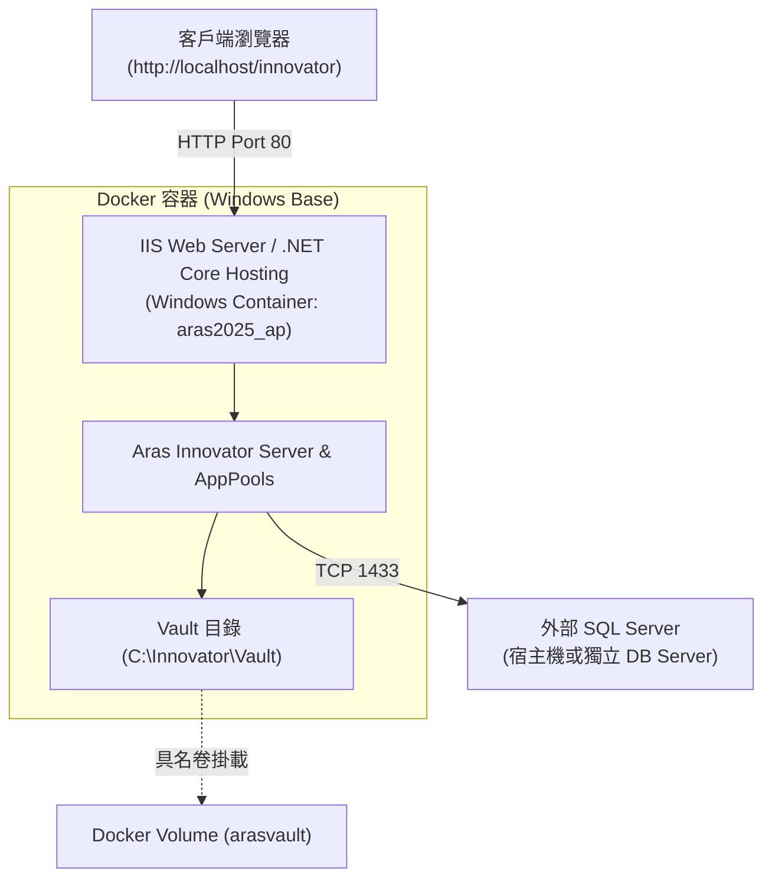

# 建立 Aras Innovator 2025 的 Docker AP 環境

嘗試使用 Aras Innovator 2025 的安裝檔案來建立 Aras Innovator 的 Docker AP 環境。本 Docker Image 只會將必要的 Windows 執行環境、.NET Hosting 與安裝腳本打包進來，並於**首次建立/啟動 Docker 容器時，才會於背景執行 Aras Innovator 的靜默安裝**（首次啟動約需 10 ~ 30 分鐘）。

> [!NOTE]
> 本環境為純 AP 應用程式伺服器容器，**內部不包含 SQL Server**。SQL Server 需由外部主機或獨立容器提供服務。

---

## 系統架構圖



---

## 專案檔案結構

| 檔案 / 目錄 | 說明 |
| :--- | :--- |
| `Dockerfile` | 建立 Windows Container AP 基礎環境的映像檔定義檔 |
| `docker-compose.yml` | 容器編排設定檔（固定 MAC 位址、連接埠映射、Volume 掛載） |
| `.env.example` | 環境變數範本檔（包含資料庫連線、安裝路徑與 License 設定） |
| `.env` | 實際運行的環境變數設定檔（已被 `.gitignore` 忽略，避免敏感資訊外洩） |
| `start.ps1` | 容器 Entrypoint 啟動腳本，負責首次靜默安裝與 IIS 監控 |
| `Update-InnovatorLicense.ps1` | 用於在已運行的容器中更新 License 授權碼的輔助腳本 |
| `UPDATE_LICENSE_README.md` | 授權碼更新腳本的使用說明文件 |
| `.gitignore` | Git 忽略清單（忽略 `.env`, `*.jet`, `*.msi`） |

---

## 一、事前準備

在開始建置前，請先確認完成以下準備事項：

1. **安裝並啟動 Docker Desktop for Windows**：
   - 必須切換至 **Windows 容器模式**（Switch to Windows containers），Aras Innovator 必須於 Windows Server Core 基礎環境下運行。
2. **確認外部 SQL Server 運行正常**：
   - 支援版本為 SQL Server 2012 以上。
   - 準備好具備管理者權限之帳密（如 `sa`），並確認（或預先規劃）`innovator` 與 `innovator_regular` 兩組資料庫 User 之密碼。
   - 建議先在宿主機使用 SSMS 驗證連線正常。
3. **下載 Aras Innovator 安裝程式 (`InnovatorSetup.msi`)**：
   - 前往 [Aras 官方下載專區](https://aras.com/en/download) 下載社群版安裝檔（本專案以 2025 版為示例，14.x 其他版本理論上亦適用）。
   - 將壓縮檔解壓後的 `InnovatorSetup.msi` 複製至本專案目錄下，並更名為：
     ```text
     InnovatorSetup-2025.msi
     ```
4. **預定義容器 MAC Address 並申請社群版授權碼 (License Key)**：
   - 前往 [Aras 社群版授權碼申請頁面](https://aras.com/en/support/licensekeyservice/community-edition?version=14.0.0)。
   - 自行預定義一組容器專用的固定 MAC 位址（例如：`00-60-56-3D-39-33`），並以該 MAC 申請授權碼。

> [!WARNING]
> **固定 MAC 位址至關重要**：
> Docker 容器預設在每次啟動時會動態分配 MAC 位址，這會導致 Aras Innovator 依據特定 MAC 綁定的授權碼失效！因此務必在 `docker-compose.yml` 中明確指定固定的 `mac_address`。

---

## 二、安裝與建置步驟

### 步驟 1：Clone 本專案至工作區
```powershell
git clone https://github.com/Jet0718/aras_innovator_2025_ap_docker.git
cd aras_innovator_2025_ap_docker
```

### 步驟 2：準備環境變數檔 (`.env`)
複製 `.env.example` 為 `.env`：
```powershell
Copy-Item .env.example .env
```
編輯 `.env`，依您的環境需求修改各項設定值：
```ini
# Aras Innovator Environment Variables
INSTALLDIR=C:\Innovator
UPGRADEORINSTALL=1
WEBALIAS=innovator
SMTPSERVER=queue
VAULTNAME=default
VAULTFOLDER=C:\Innovator\Vault
DB_CREATE_NEW_OR_USE_EXISTING=0

# SQL Server 連線設定
# 若 SQL Server 在宿主機本機，可嘗試使用 host.docker.internal；若在外部主機請填入實際 IP
IS_SQLSERVER_SERVER=192.168.10.125
IS_SQLSERVER_DATABASE=InnovatorDB
IS_SQLSERVER_AUTHENTICATION=1
IS_SQLSERVER_USERNAME=sa
IS_SQLSERVER_PASSWORD=Password@openplm
SQL_SERVER_LOGIN_NAME=innovator
SQL_SERVER_LOGIN_PASSWORD=innovator
SQL_SERVER_LOGIN_REGULAR_NAME=innovator_regular
SQL_SERVER_LOGIN_REGULAR_PASSWORD=innovator

# 服務與元件安裝
INSTALL_CONVERSION_SERVER=1
CONVERSION_SERVER_NAME=ConversionServer
CONVERSION_SERVER_APP_URL=http://localhost/Innovator/Server/InnovatorServer.aspx
INSTALL_AGENT_SERVICE=1
ARAS_AGENTSERVICE_TO_INNOVATORSERVER_URL=http://localhost/Innovator/Server/InnovatorServer.aspx
INNOVATOR_TO_SERVICE_ADDRESS=http://localhost:8734/
AS_FOLDER=ArasInnovatorAgent
INSTALL_INNOVATOR_SERVER=1
INSTALL_VAULT_SERVER=1
INSTALL_OAUTH_SERVER=1

# 社群版授權碼（需與下方指定的 MAC 位址相符）
LICENSEKEY=<License lic_type="Unlimited" lic_key="..." act_key="..."/>
```

### 步驟 3：確認 `docker-compose.yml` 設定
請確認 `docker-compose.yml` 內的 `mac_address` 與申請授權碼時所填寫的 MAC 完全相符：
```yaml
services:
  innovator-ap:
    container_name: aras2025_ap
    build:
      context: .
      dockerfile: Dockerfile
    env_file:
      - .env
    mac_address: 00-60-56-3D-39-33   # 請替換為您申請 License 的 MAC 位址
    ports:
      - "80:80"
    mem_limit: 6g
    volumes:
      - arasvault:C:\Innovator\Vault

volumes:
  arasvault:
```

### 步驟 4：建立映像檔並啟動容器

您可依實際需求選擇**本機建置**或**使用 Docker Hub 現成映像檔**：

#### 選項 A：本機建置 Docker Image（建議）
```powershell
# 依 Dockerfile 建立映像檔（會將 InnovatorSetup-2025.msi 與 start.ps1 包入映像）
docker-compose build

# 背景啟動容器
docker-compose up -d
```

#### 選項 B：使用 Docker Hub 現成映像檔
若不自行本機建置，可使用 Docker Hub 上發佈之映像檔：
```powershell
docker pull jetlo0718/innovator_pre_env:2025a
docker-compose up -d
```

> [!NOTE]
> `docker-compose up -d` 指令會很快完成，但容器在**首次建立與運行時會在背景執行 Aras Innovator 靜默安裝程序**，整體過程約需 10 ~ 30 分鐘，請耐心等候。

### 步驟 5：監控安裝進度與確認服務狀態

透過以下指令可隨時檢視容器安裝進度與日誌輸出：
```powershell
docker logs -f aras2025_ap
```

當看到以下成功訊息時，即代表 Aras Innovator 已完成安裝且 IIS 服務正常運作：
```text
Executing silent installation... this may take some time.
msiexec.exe installation completed successfully.
Installation completion flag file created.
Checking IIS configuration...
Website list:

name             state   physicalPath                 
----             -----   ------------                 
Default Web Site Started %SystemDrive%\inetpub\wwwroot

Application list:

path                        PhysicalPath                   applicationPool     
----                        ------------                   ---------------     
/innovator                  C:\Innovator\Innovator\        Aras Innovator Ap...
/innovator/Client           C:\Innovator\Innovator\Client\ Aras Innovator Ap...
/innovator/ConversionServer C:\Innovator\ConversionServer\ Aras Conversion A...
/innovator/OAuthServer      C:\Innovator\OAuthServer\      Aras OAuth AppPoo...
/innovator/Server           C:\Innovator\Innovator\Server\ Aras Innovator Ap...
/innovator/Vault            C:\Innovator\VaultServer\      Aras Vault AppPoo...

Testing SQL Server connection...
SQL Server connection successful.
Ensuring World Wide Web Publishing Service (w3svc) is running...
w3svc service is running.
Container is running. Monitoring w3svc service...
```

### 步驟 6：連線使用
安裝完成後，即可於宿主機瀏覽器存取系統：
- **登入首頁**：[http://localhost/innovator](http://localhost/innovator) 或 [http://localhost/innovator/Client](http://localhost/innovator/Client)
- **預設管理者帳密**：`admin` / `innovator`

---

## 三、授權碼動態更新工具

若日後需要更換授權碼（License Key），無須重新安裝整個容器，可直接在宿主機利用本專案附帶之 `Update-InnovatorLicense.ps1` 進行動態更新：

```powershell
.\Update-InnovatorLicense.ps1 -ContainerName "aras2025_ap" -LicenseString '<License lic_type="Unlimited" lic_key="YOUR_KEY" act_key="YOUR_ACT_KEY"/>'
```

- 該工具會自動備份配置檔、替換容器內的 `InnovatorServerConfig.xml` 授權節點，並重啟 IIS AppPool 使授權立即生效。
- 詳細使用範例與復原說明請參考 [UPDATE_LICENSE_README.md](UPDATE_LICENSE_README.md)。

---

## 四、常見問題與排除 (FAQ)

1. **安裝失敗，Exit Code 非 0（如 `16XX`）**：
   - 表示 `msiexec.exe` 安裝程序報錯。常見原因包含 SQL Server 連線失敗或權限不足。
   - 安裝記錄檔 `InnovatorSetupLog.log` 會輸出在 Docker Volume 中（例如宿主機位置：`C:\ProgramData\Docker\volumes\aras_innovator_2025_ap_docker_arasvault\_data`），可藉此日誌深入分析失敗原因。
2. **無法連線至 SQL Server**：
   - 請先在宿主機使用 SSMS 驗證 SQL Server 服務是否正常運作。
   - 若 SQL Server 架設於同一台宿主機，請將 `.env` 中的 `IS_SQLSERVER_SERVER` 設定為 `host.docker.internal`。
   - 若為外部 SQL Server，請檢查網路連通性與防火牆 1433 連接埠。
3. **資料庫已存在錯誤**：
   - 本安裝預設以建立新資料庫為目標（`DB_CREATE_NEW_OR_USE_EXISTING=0`），若 SQL Server 中已存在同名資料庫，安裝將會中斷失敗。請先至資料庫伺服器手動刪除該資料庫，或修改 `.env` 中的 `IS_SQLSERVER_DATABASE`。
4. **反覆執行 `docker-compose up -d` 重新安裝**：
   - 由於 `start.ps1` 預設設定 `UPGRADEORINSTALL=1`，重新執行可能會重跑安裝流程。若要徹底重置乾淨環境，建議先執行 `docker-compose down -v` 清除舊容器與具名卷，並確認 SQL Server 上的舊資料庫已移除後再重新建置。

---

## 五、修訂記錄

- **2026-10-25**：
  - 修改 `start.ps1` 內之輸出說明，全面改用英文輸出，避免 Windows 容器環境中的終端編碼亂碼問題。
  - 增加授權碼動態更新工具 `Update-InnovatorLicense.ps1` 與使用指南 [UPDATE_LICENSE_README.md](UPDATE_LICENSE_README.md)。
  - 新增 `.gitignore`，將 `.env`、`*.jet`、`*.msi` 排除於 Git 追蹤外。
  - 全面優化與結構化 `README.md` 說明文件。
- **2026-02-16**：
  - 將映像檔基礎平台自 `aspnet:4.7.2-windowsservercore-ltsc2019` 升級為 `mcr.microsoft.com/dotnet/framework/aspnet:4.8-windowsservercore-ltsc2022`。
  - 將 .NET Core Hosting Bundle 由 `dotnet-hosting-8.0.18-win.exe` 升級為 `dotnet-hosting-8.0.24-win.exe`。
  - *備註*：在建置 Image 時，若 Docker 內部無法下載 hosting bundle，可在 Docker Desktop 的 Settings -> Docker Engine 中配置 DNS Server（例如 `8.8.8.8`），以利容器能順利解析微軟下載網址。

---

**作者**：羅仁 Jet Lo
